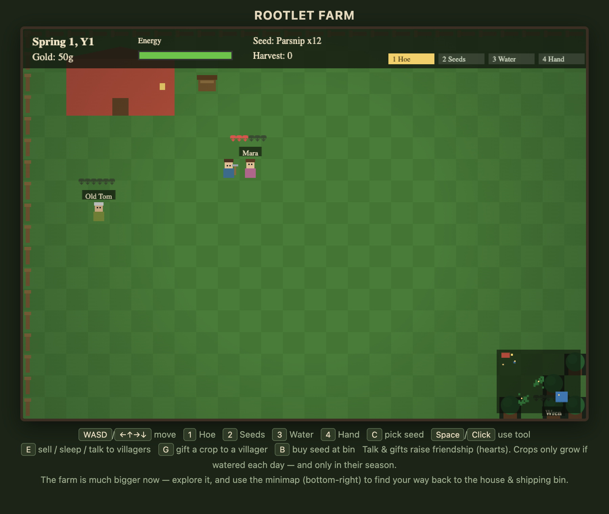
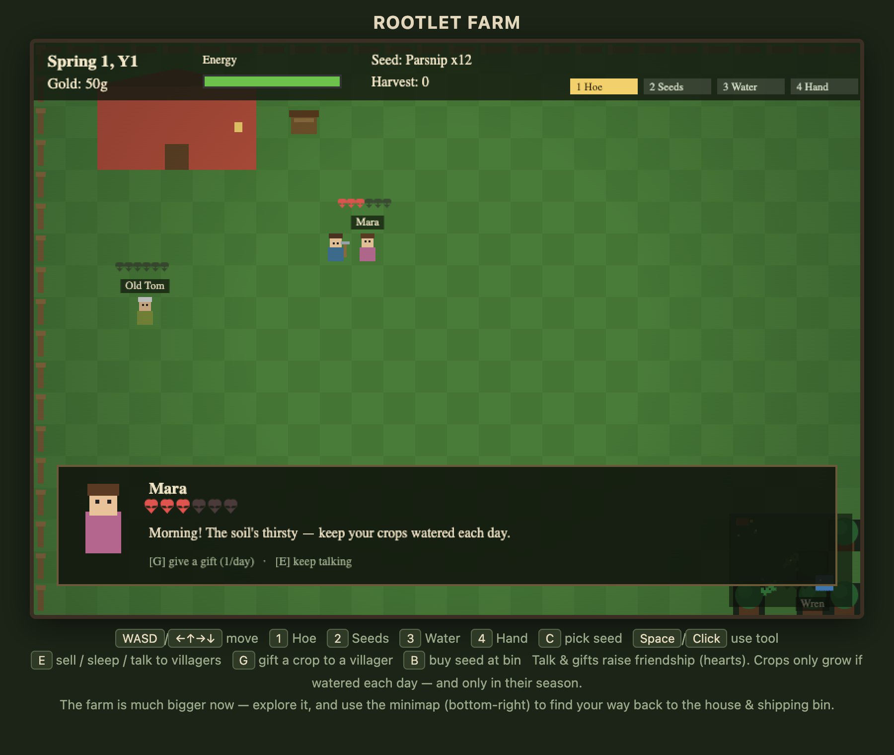

# Stardrew-Valley-Demo

A tiny browser farming sim ("Rootlet Farm") inspired by *Stardew Valley*, built from
reverse-engineering the game's mechanics (see the `stardew_re` work). It is **original
code** — no game assets or decompiled source are included.

## What it models (grounded in the RE)

- **Calendar** — 4 seasons × 28 days (matches `WorldDate`: `GetDaysPlayed = (year-1)*4 + season)*28 + day-1`).
- **Seasonal visuals** — grass palette + mood tint shift per season; snow instead of rain in Winter.
- **Crops as data** — a small catalog (Parsnip, Potato, Blueberry, Tomato, Pumpkin, Wheat) with approximate
  factual grow-days, sell price, seed price, and which seasons they may be planted in.
- **Watering-gated growth** — a crop only advances a day if its tile was watered (or it rained), exactly like
  the `Crop.phaseDays` / `dayOfCurrentPhase` model.
- **Regrowable crops** — e.g. Tomato / Blueberry keep producing after harvest (`regrowDays`).
- **Withering** — crops not valid in the new season die at the season change (`Crop.dead`).
- **Seed economy** — buy seeds at the shipping bin, sell harvest there.
- **Bigger world + camera** — the farm is now 48×36 tiles (was 26×18) with a player-following
  camera viewport and a minimap (bottom-right) so you can explore without losing your way.
- **Forest & groves** — a deterministic tree border plus a couple of interior groves frame the
  farmland; trees are solid obstacles, the home/farm yard stays clear.
- **Villagers (NPCs)** — five original homage characters (Mara, Old Tom, Pim, Wren, Bram) stand around
  the farm, are solid (you can't walk through them), appear as labeled dots on the minimap, and will
  give you a flavor line when you press `E` nearby.
- **Interaction / friendship system** — talk to a villager for the day (`E`), or give them a gift of a
  crop you've harvested (`G`). Each villager has invented `loves` / `likes` tastes. Points convert to
  **hearts** (250 pts = 1 heart, max 6); talking is +20/day, a loved gift +80, liked +45, neutral +20,
  and you only get **one talk and one gift per villager per day** — a simplified homage of the game's
  affection model. A dialogue panel shows their pixel portrait, name, heart row, and line.

## Controls

| Key | Action |
|-----|--------|
| `WASD` / arrows | Move |
| `1` `2` `3` `4` | Hoe / Seeds / Water / Hand |
| `C` | Cycle selected seed |
| `Space` / Click | Use tool on facing tile |
| `E` | Sell harvest at bin / sleep at door / talk to a nearby villager |
| `G` | Give a held crop to a nearby villager (gift) |
| `B` | Buy 1 seed at bin |

## Screenshots (real runs, not mockups)

Actual screenshots taken from the running demo in a headless Chromium — this is the whole thing
in `index.html`, no assets, no engine:

## Original work & licensing

This is an **original homage**, not a copy and not a redistribution of the game:

- Every sprite, tile, portrait, name, and line here is **original code drawn with canvas primitives**.
- **No game assets** (art, audio, fonts, maps, `.xnb` content) and **no decompiled game source** are
  included in this repository. The reverse-engineering of `Stardew Valley.dll` was done locally, for
  personal study only, and stays out of this repo.
- Only the *structure* of some mechanics (a 4×28 calendar, water-gated crop growth, seasonal
  withering, a points→hearts affection model) was informed by that study. All numbers, characters,
  art, and code here are freshly written for this demo.

So the screenshots above are the proof: what you see is entirely original artwork and original
character names, drawn at runtime.

## Run it

Open `index.html` in any browser. Till soil, plant a season-appropriate seed, water it every day,
sleep at the house door (`E`) to advance the day, and harvest when mature.

## Notes

- Pure client-side, single file, no build step.
- Mechanics are simplified for a demo; they mirror the *structure* observed in the decompiled `Crop` /
  `WorldDate` classes, not the game's exact numbers or code.
